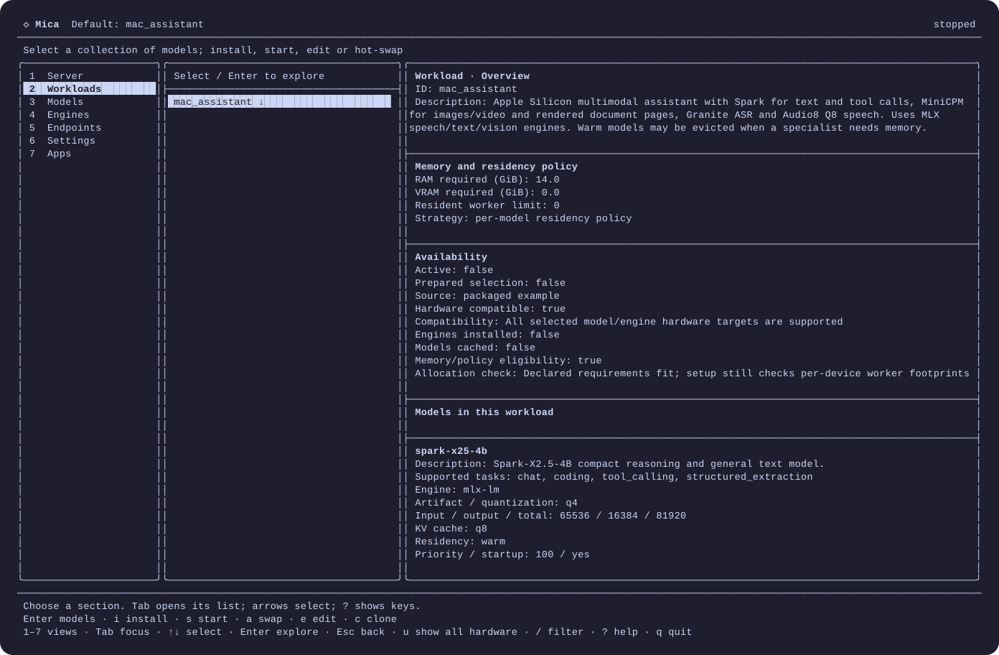

<p align="center">
  
</p>

# Mica Server

**Your models. Your engines. One local server.**

Mica is a configurable local AI hosting server, proxy, and memory-aware model
load balancer. Choose a **workload**—a collection of models for your task—and
Mica resolves compatible engines, prepares dependencies and artifacts, and
loads or swaps models behind one authenticated API.

The core idea is **shareable YAML configuration**, not a fixed model set.
Combine models for chat, coding, vision, speech or retrieval. Keep them resident
when memory permits, load them sequentially, or balance residency by priority.
Switch workloads without deleting caches; compatible workers stay loaded.

> [!WARNING]
> **Alpha: active development, deslopification and ongoing tests.** Integrations
> and APIs may change. Declared compatibility is not inference certification.
> Memory reservations are estimates, not a universal hard RSS/VRAM cap.
> Do not expose Mica directly to an untrusted network.

## Why Mica

| Capability | What it gives you |
| --- | --- |
| **Workload profiles** | Share and switch model collections for assistants, coding, meetings, visual analysis or your own tasks. |
| **Memory-aware serving** | Lazy loading, residency priorities, idle eviction and hot-swaps that retain compatible workers. |
| **Multiple engines** | Hardware-aware installation/build recipes for registered native GGUF, MLX and vLLM integrations. |
| **One API** | Route chat, media, speech, embeddings and other implemented operations to compatible models. |
| **Native TUI** | Inspect hardware, workloads, models, engines and endpoints; configure, start, stop and swap. |
| **Mica Client** | CLI, native TUI and HTML app management; install verified apps on your device and connect them to local or remote inference. |
| **Small control plane** | C++/Lua orchestration; Python only for engines or optional clients that need it. |

A model's abilities and its engine's implemented contracts determine available
operations. Adding a model requires a compatible registered engine/adapter;
Mica does not claim universal compatibility with every model or engine.

## Start with the terminal interface

[Install Mica](docs/getting-started.md), then run:

```sh
mica-server tui
```



*Actual terminal capture from an isolated application home, without inference
or private credentials.*

| View | Main actions |
| --- | --- |
| **Server** | Status, active/default workload, loaded model names, start/stop/swap; machine information and updates. |
| **Workloads** | Browse, install, start, edit/clone YAML, and navigate to the collection's models. |
| **Models** | Categories, tasks, modalities, context, artifacts, projectors/drafters, and supported engines. |
| **Engines** | Hardware support, installation, revisions, build recipes and endpoint contracts. |
| **Endpoints** | Registered routes, descriptions, authentication and example calls. |
| **Settings** | Address, port, default workload, RAM/VRAM, API-key rotation and release/source updates. |
| **Apps** | Inspect and manage apps hosted on this server; use `mica-client` for discovery and device-local installation. |

**1–7** select views; **Tab** changes focus; **↑/↓** select; **Enter** explores;
**Esc** returns. **g** cycles model categories; **u** reveals incompatible entries.
Actions require confirmation. Closing the TUI leaves the server running.
[TUI walkthrough](docs/tui.md).

## Or manage each host from your browser

```sh
mica-server start --dashboard --host 0.0.0.0 --port 55000
```

Open `http://HOST:55000/dashboard` from a device that can reach that host.
The dashboard is **off by default**, unless enabled in your saved configuration.
`--dashboard` enables it for this launch; to keep it enabled for later CLI/TUI
starts, use `mica-server config set --dashboard --restart`. If Mica is stopped,
this saves the setting; run `mica-server start` afterward.

```sh
mica-server dashboard         # Show actual local/network URLs and admin-key path
mica-server dashboard --open  # Open a browser on the machine running this command
mica-server start --help      # Startup, defaults, dashboard and LAN instructions
```

The dashboard shares the API listener: `/dashboard`, **not a separate port**.
Without saved settings/flags the API port is 55000. From another device use
the server's IP, not `localhost` or `0.0.0.0`.
Each Mica instance serves its own dashboard: server/workload controls, model
and engine inventory, optional apps, endpoint examples, settings and background
job logs. Plain HTML/CSS/JavaScript uses Mica's existing C++ HTTP server:
**no additional web framework, Python service, npm installation or CDN**.

Dashboard access uses a distinct **admin key**, created in
`~/.mica/secrets/admin-api-key` when enabled. The existing
`~/.mica/secrets/api-key` remains the inference key for apps. Rotation applies
live; rotating admin access does not change app credentials. This browser tab
remembers login across refreshes using session storage; Disconnect clears it.

Browser apps open through `/apps/<id>/…` on that same server, without extra
public ports. In the TUI use **Apps → o**; from CLI use
`mica-server app open APP_ID --accept-code`. Web apps open in the browser;
native TUI apps open in the terminal. Apps can also be downloaded to your device and use remote
inference without a local Mica server. Local inference setup is optional.
The native Dictation client has a connection TUI and desktop recording shortcut;
both demo apps also expose stdio MCP tools. [App setup and limits](docs/apps.md).

`Stop inference` drains requests and unloads workers while keeping the
dashboard available. `Stop Mica` closes the whole process; use CLI/SSH to start
it again. Network/allocation edits may restart Mica; workload preparation pauses
inference without restarting the control plane. Use a trusted network or
encrypted overlay; built-in HTTP does not provide TLS. Disabled by default;
initial workload setup is still required.
[Dashboard controls and authentication](docs/api.md#dashboard-and-administration).

## Configuration is the architecture

```text
Hardware discovery ──► machine policy: devices and global allocations
                               │
Engine YAMLs ────────► compatible install/build/launch recipes
                               │
Model YAMLs ─────────► modalities, abilities, context + artifact bundles
                               │
Workload YAMLs ──────► model collection, budgets, placement, KV and residency
                               │
                               ▼
                         Mica server
                    admit · load · route · swap
                               │
                  ┌────────────┴────────────┐
                  ▼                         ▼
             Unified API              Native TUI
                  │
                  ▼
           Optional client apps
           + bundled workloads
```

Models declare supported engines and artifacts. A workload may pin a choice
or let Mica prefer an installed compatible engine, then the model's declared
order. Projectors, codecs and drafters belong to artifact bundles. Context,
placement and residency are workload policies. Workload requirements and limits
must fit the global machine allocation.

Workloads define model collections; the server's **global scheduler** governs
residency across them: **single** keeps one worker, **high** retains as many as
the budget allows, and **balanced** favors high-priority workers. Requests bind
to a workload, shared compatible workers are reused, and busy workers finish
before eviction. Component/KV estimates support admission; they are not
measurements of peak process memory. Workload `all`/`sequential` planning estimates
remain available but do not override the server strategy.
[Configuration contract](docs/design/configuration-contract.md) ·
[Workload design](docs/profiles.md) · [Scheduling](docs/scheduling.md) · [Memory planning](docs/memory-estimation.md).

## Useful commands

```sh
mica-server workload list
mica-server workload install WORKLOAD_ID --ram-gib 16
mica-server start --workload WORKLOAD_ID
mica-server status
mica-server config set --strategy balanced
mica-server workload activate OTHER_PREPARED_WORKLOAD_ID
mica-server endpoints
mica-server stop
```

Use IDs from the workload list. Setup installs missing dependencies and models;
hot-swapping requires a prepared workload. Localhost is the default; use
`--host 0.0.0.0` only for a trusted LAN, with authentication configured.

```sh
mica-server update --check
mica-server update --restart
mica-server update --channel source --restart
```

Updates prefer a compatible release binary; otherwise they compile under
live-memory safeguards. Binary/configuration updates preserve application
settings and model caches. API-key rotation shows the new key in a temporary
copy dialog while existing keys remain redacted.
[Updating and older-binary bootstrap](docs/updating.md).

## Apps that use your workloads

The default **Mica demo apps** source includes:

- **Local Assistant:** the existing browser chat, with streaming, attachments,
  optional voice, workload selection and conversation import/export.
- **Dictation:** a native WhisperFlow-style demo: desktop shortcut or recording
  controls → ASR → optional LLM cleanup → clipboard / opt-in macOS paste.

Each app has its own folder, `app.yaml`, verified assets and default workloads.
Apps reuse Mica's API and shared caches. Each app binds its requests to its own
workload, so multiple apps can stay open without switching the server default
or restarting it. The scheduler loads/offloads models as requests arrive.
Use the separate device-local manager, included in the same repository:

```sh
mica-client tui
mica-client ui --open
mica-client discover
mica-client install mica-dictation --accept-code
```

Add GitHub/Hugging Face repositories or direct HTTPS manifests/indexes through
Mica Client. The server dashboard lists apps installed on its host, not a device
catalogue. Every package file has a verified SHA-256. Installation,
workload setup and code execution are separate actions. Downloaded code is
**not sandboxed**—only launch publishers you trust. The optional browser demos
use Python's standard library, without a pip environment.
[App setup, packaging and lifecycle](docs/apps.md).

The app runs on the device where it is installed; inference can run elsewhere.
Choose local inference (detect/reuse a server, or explicitly approve installation),
remote inference, or configure later. App installation never silently installs
engines/models or restarts a server. [Mica Client guide](docs/client.md).

**Ports:** `55000` server API/dashboard, `55001` client UI, private reusable pools
`55200–55399` for app services and `55900–55999` for inference workers. Web apps
share `/apps/APP_ID/` on their host's listener. [Port allocation](docs/ports.md).

## Footprint and documentation

C++20 and embedded Lua implement the CLI, TUI, discovery and scheduling.
Native GGUF serving does not require Python; MLX/vLLM and some optional clients
do. Backend environments and models are separate from the core binary.
Application state defaults to `~/.mica` (`MICA_HOME` or `--root` overrides it).

- [Install and run](docs/getting-started.md), including Linux GPU setup
- [TUI](docs/tui.md) · [Client](docs/client.md) · [Apps](docs/apps.md) · [Ports](docs/ports.md) · [Updating](docs/updating.md)
- [Workloads](docs/profiles.md) · [Engines and artifacts](docs/engines-and-profiles.md)
- [API reference](docs/api.md) · [Schema vocabulary](docs/schema-vocabulary.md)
- [Configuration schemas](docs/configuration-schemas.md) · [Models](docs/models.md)
- [Memory estimates](docs/memory-estimation.md) · [Measured profiling](docs/model-memory-profiling.md)
- [Validation evidence](docs/validation/) · [Development](docs/development.md)

## Roadmap

- [ ] Native macOS/Linux desktop app for Mica management.
- [ ] Expand desktop dictation permission, shortcut and Wayland testing.
- [ ] Signed app publishers, app upgrades and trusted distribution recipes.
- [ ] Image-generation and music/audio-generation engine integrations.
- [ ] Complete vLLM certification on native CUDA/ROCm/XPU hardware.
- [ ] Expand hardware-specific inference, concurrency and memory testing.

## License

[GPL-3.0](LICENSE). Model artifacts and third-party apps retain their own
licenses; consult their model cards and manifests before redistribution.
